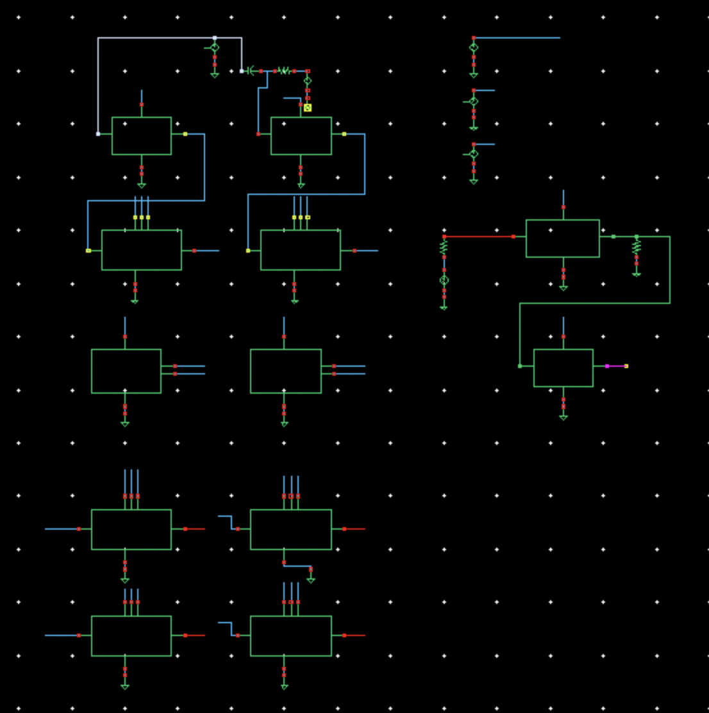
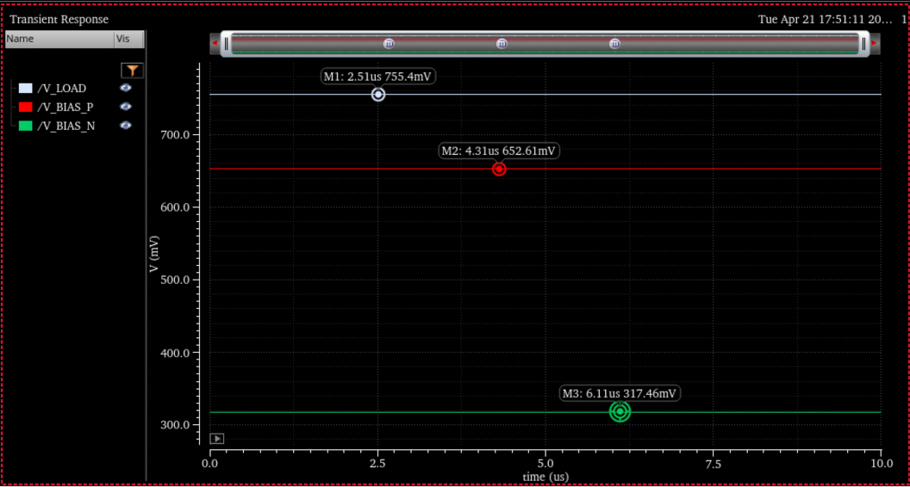

# cmos-kws-skill

Cadence SKILL generators from a CMOS keyword-spotting course project (Introduction to VLSI, Johns Hopkins, Spring 2026, with Andrew Chae). The detector is a mixed-signal design in the gpdk045 kit: two 1,024-stage shift registers feed weighted current-mode banks whose summed output is thresholded to flag a matched audio pattern.

Hand-drawing hundreds of near-identical tap and branch schematics in Virtuoso was the bottleneck, so these scripts build the Week 2 cells, symbols and a net-label-based testbench directly in the CIW.

## Scripts (load in this order)

| File | Builds |
|---|---|
| `00_probe.il` | Environment check: libraries, PDK cells, permission to create and delete a scratch cellview. Prints `probe PASS` or lists what is missing. |
| `01_term_introspect.il` | Places one `pmos2v` and prints every candidate access path for terminal positions, used once to learn the right API on this Cadence build. |
| `tap_cells.il` | `tap_pos` and `tap_neg` schematics plus symbols (thick-oxide `pmos2v`/`nmos2v`, VDD 1.8 V). |
| `branch_gen.il` | `buildBranch(name, pattern)`: an 8-tap weighted branch from a `+`/`-` string, e.g. `buildBranch("A" "+-+-+-+-")`. |
| `week2_tb_synth.il` | Fully scripted testbench. All connectivity is by net label, so no routing code; `vdd!` and `gnd!` are global nets. |

```
load("00_probe.il")
load("tap_cells.il")
load("branch_gen.il")
buildBranch("A" "+-+-+-+-")
buildBranch("B" "++++----")
load("week2_tb_synth.il")
```

Each script removes and rebuilds only the cells it owns, so reruns are safe. Nothing here touches the PDK or analogLib, and no PDK files are included in this repo.

## Results from the project

Matched, anti-matched and all-taps-active inputs on the 16-tap demonstration bank settled at 755 mV, 272 mV and 526 mV respectively. The four-bank extension passed schematic and DC checks; the full transient run was not completed because of disk limits on the course server. Schematic-level work only, no layout or fabricated chip.





Figures are from the team final report (Zhang and Chae). My parts of the design: transmission gates, inverters and flip-flops for the shift registers, the current-mode bank subcells, bias circuits, the threshold block and the integration testbench, plus these generator scripts.
